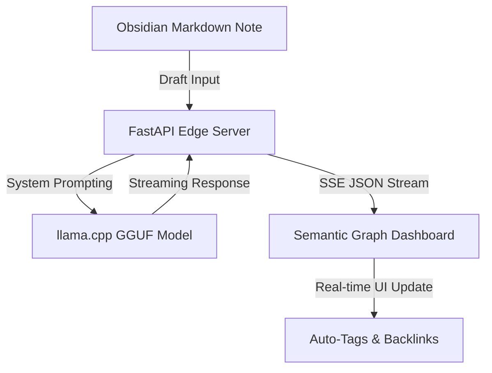

<div align="center">
  <h1>🧠 Second Brain Semantic Agent</h1>
  <p><strong>A Local, Edge-Optimized RAG & Knowledge Graph Automator</strong></p>
</div>

<br/>

## 🎯 Overview

The Second Brain Semantic Agent is a powerful, locally-hosted LLM system designed to automate knowledge management. It integrates into Markdown-based "Second Brain" setups (like Obsidian) to automatically read unstructured notes and generate precise Knowledge Graph metadata—such as semantic tags, folder categorizations, and backlink recommendations.

This project demonstrates the ability to build, fine-tune, and deploy highly-specialized AI assistants that process personal data locally, ensuring absolute privacy and zero reliance on expensive cloud API subscriptions.

## ✨ Key Features

- **Semantic Data Extraction**: Parses raw Markdown and outputs deterministic JSON containing tags, categories, and summaries.
- **Local & Private inference**: Uses `llama.cpp` to run quantized 4-bit models entirely locally, keeping personal notes completely private.
- **QLoRA Fine-Tuning**: Includes scripts to generate synthetic dataset pairs and fine-tune lightweight models (Llama-3.2-3B) for this highly specific extraction task using Unsloth.
- **Streaming Obsidian UI**: Features a beautiful, responsive dark-mode frontend that simulates an Obsidian workspace, showcasing Server-Sent Events (SSE) streaming capabilities.

---

## 🏗 Architecture



---

## 🚀 Getting Started

### Prerequisites
- Python 3.11+
- Docker & Docker Compose (Optional, for containerized deployment)

### 1. Fine-Tuning & Quantization
To create your own semantic tagging model:
1. Review `training/generate_data.py` to see how synthetic Markdown $\rightarrow$ JSON training data is created.
2. The `training/train.py` script leverages Unsloth for ultra-fast QLoRA training on consumer GPUs (or Colab Free tier).
3. Export the model to GGUF (`q4_k_m`) and drop it into the `backend/` folder.

### 2. Running the Agent (Emulator Mode)
Don't have a GPU or model weights right now? No problem! The backend comes with a smart **Emulator Mode**. If the model file is missing, it will use high-fidelity heuristics to simulate the LLM's streaming JSON generation so you can test the UI instantly.

```bash
cd backend
pip install -r requirements.txt
uvicorn main:app --reload
```

### 3. Launching the Dashboard
Open `frontend/index.html` in your web browser. Type or paste a Markdown note into the editor pane, and click **Ask Agent ✨** to watch the semantic knowledge graph build itself in real time.

### 4. Container Deployment
Run the entire stack in an isolated, resource-constrained container:
```bash
docker-compose up --build
```

---

## 🛠 Tech Stack

- **ML Pipeline**: Hugging Face, Unsloth, llama.cpp, QLoRA
- **Backend**: Python, FastAPI, Uvicorn, Server-Sent Events (SSE)
- **Frontend**: Vanilla JS, HTML5, CSS3
- **Infra**: Docker
